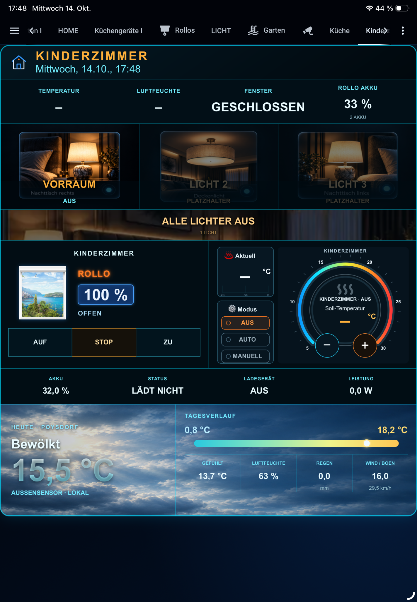

# Frankys_Stuff Room Card v0.3.0

<p align="center">
  
</p>

A self-contained Home Assistant Lovelace room card for wall displays and tablets.

## Features

- Room status: temperature, humidity and window/door state
- 3 configurable light controls plus "all lights off"
- Up to 4 covers/blinds with popup control and optional battery sensors
- Integrated climate controller — no separate Climate Card required
- Recorder-backed 24-hour temperature history
- Heating schedule editor with automatic schedule discovery/creation
- Optional heating-status binary sensor
- Integrated weather view with current values and 7-day forecast
- Tap/click the weather area to switch between daily values and 7-day forecast
- Eight weather backgrounds embedded directly in the JavaScript file
- Shutter/window background embedded directly in the JavaScript file
- Automatic German/English language selection
- Simple visual editor; advanced overrides are grouped under **Experteneinstellungen**
- No runtime dependency on Frankys_Stuff Climate Card, Frankys_Stuff Weather Card, Enhanced Shutter Card or local image folders

## Card type

```yaml
type: custom:frankys-stuff-room-card
```

## Manual installation

1. Copy `frankys-stuff-room-card.js` to:

   `/config/www/frankys-stuff/room-card/frankys-stuff-room-card.js`

2. Open **Settings → Dashboards → Resources**.

3. Add:

   `/local/frankys-stuff/room-card/frankys-stuff-room-card.js?v=0.3.0`

4. Select **JavaScript Module**.

5. Reload the frontend. When replacing an older file, use a hard refresh or reset the Home Assistant frontend cache.

## Minimal example

```yaml
type: custom:frankys-stuff-room-card
name: Schlafzimmer
temperature_entity: sensor.schlafzimmer_temperatur
humidity_entity: sensor.schlafzimmer_luftfeuchte
climate_entity: climate.schlafzimmer
light_1: light.nachttisch_links
light_2: light.deckenlicht
cover_entity: cover.schlafzimmer
weather_entity: weather.home
```

The entity IDs above are examples only. Select your own Home Assistant entities in the visual editor.

## Climate

For normal thermostat use, selecting the room's `climate` entity is sufficient.

The schedule control looks for a Home Assistant schedule linked to the configured climate entity. If none exists, the card can create one when the schedule is saved.

Separate target/mode helpers, scripts, `schedule_entity`, heating-status sensor, temperature limits and step size are optional settings under **Experteneinstellungen**.

## Weather

A Home Assistant `weather.*` entity can be used directly. If no weather entity is configured, the card can use Open-Meteo with the coordinates of `zone.home`.

The Open-Meteo fallback requires internet access. For offline/local operation, configure a suitable Home Assistant weather entity.

## Independence

The release is a single runtime JavaScript file. Weather artwork and the shutter/window background are embedded, so the separate Weather Card, Climate Card and Enhanced Shutter Card do not need to be installed.

## Licensing

- Frankys_Stuff Room Card source: **MIT License** — see `LICENSE`.
- The embedded shutter background includes `esc-view.png` from **Enhanced Shutter Card** by marcelhoogantink, distributed under GPL-3.0. See `THIRD_PARTY_NOTICES.md` and `LICENSES/GPL-3.0.txt`.

## Tested release

v0.3.0 was tested on 2026-10-14 in Home Assistant using a separate release-test view. Light, cover, display, weather, climate and schedule-related UI functions were checked without replacing the existing private RoomCard.

## Version

**Frankys_Stuff Room Card v0.3.0**


## Support

If you like Frankys_Stuff Room Card and want to support further development:

**Ko-fi:** https://ko-fi.com/Frankys_Stuff
